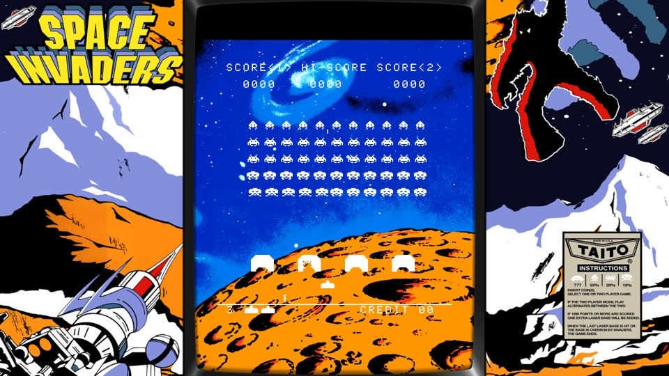

# Space Invaders (1978) — Original Arcade Game Translated to Python

**A preservation-focused translation of the original Intel 8080 Space Invaders arcade logic into native Python — not a CPU emulator, and not a modern remake.**

This project takes the routines of the 1978 arcade game and expresses their behaviour in readable Python. The goal was to retain the original game's decisions, timings, interactions, and even its quirks, while making the code easier to run, explore, and learn from.

It is a complete playable release built with [Pygame Community Edition](https://pyga.me/), with optional period-style colour strips and arcade cabinet artwork.

> **Version 1.0:** Gameplay development is complete. Extensive comparisons with MAME were used to validate the translation; this is a faithful recreation, not a claim of cycle-perfect equivalence in every possible situation.



*Cabinet composition preview; replace with a fresh in-game screenshot if preferred.*

## Why this version exists

Many Space Invaders projects recreate the *appearance* of the original game using new logic. Others run the original machine code inside an Intel 8080 emulator.

**This project takes a different approach:** translate the original game algorithms into Python and retain their behaviour. That includes details which are easy to miss in a conventional remake:

- The authentic 55-invader formation, movement, animation and firing patterns.
- Three distinct enemy missile types: rolling, plunger and squiggly.
- Original player movement, shooting, collisions, lives and two-player play.
- Shields that are progressively eaten away by shots and invaders.
- The mystery saucer, its scoring behaviour and the game's attract-mode sequences.
- The original interrupt-driven ordering and game-state interactions.
- Original oddities and graphical quirks, deliberately left intact.
- Sound hardware is not replicated, but uses .WAV recordings for simplicity.

The code is divided into Python modules covering the game objects, interrupts, enemies, player combat, shields, sound and display. **You do not need a ROM image or MAME to run it.**

## Quick start (Windows)

**Requirements:** Python 3.12 or newer and `pygame-ce` 2.5.8 or newer (below 3.0).

1. Download or clone this repository.
2. Run **`INSTALL.cmd`** once to install the Python dependency.
3. Run **`PLAY_CABINET.cmd`** to launch the arcade cabinet presentation, or **`PLAY.cmd`** for the plain game.

Or use Command Prompt:

```bat
python -m pip install -r requirements.txt
python play.py
```

To start directly with the arcade cabinet artwork:

```bat
python play.py --artwork cabinet --overlay classic
```

The window is movable. Artwork modes use fixed window sizes and whole-number scaling to preserve the game's original sharp, square pixels.

## Original arcade DIP switch options

The Midway arcade machine allows the operator to select **3–6 starting ships** and a **bonus ship at either 1,000 or 1,500 points**. These settings are implemented in Python using the existing lives and scoring routines; they do not change the game's timing code.

**Release defaults: 3 ships and a bonus at 1,000 points.** Normal `PLAY.cmd` and `PLAY_CABINET.cmd` use these defaults.

From Windows Command Prompt, choose settings with MAME-style short options:

```cmd
python play.py -lives 6 -bonus 1500
python play.py --artwork cabinet --overlay classic -lives 4 -bonus 1000
```

The longer Python options work equally well:

```cmd
python play.py --starting-lives 6 --bonus-life 1500
```

| Option | Values | Default |
| --- | --- | --- |
| `-lives` / `--starting-lives` | 3, 4, 5, 6 | 3 |
| `-bonus` / `--bonus-life` | 1000, 1500 | 1000 |

The MAME **Display Coinage** DIP switch is deliberately not included as a player-facing option here. It is not needed for the gameplay choices above. For MAME comparisons, select matching DIP settings in MAME and Python before starting each run. Changing the defaults from an older build may affect comparison traces involving bonus-life awards.

## Display modes

The original game is monochrome. The historical arcade presentation used coloured overlays and cabinet artwork; those effects are **optional display layers**, not modifications to game logic or VRAM.

| Launcher | What you see |
| --- | --- |
| `PLAY.cmd` / `PLAY_MONO.cmd` | Original white-on-black gameplay |
| `PLAY_COLOUR.cmd` | Classic red-and-green colour-strip effect |
| `PLAY_BACKDROP.cmd` | Moon backdrop with the game in front |
| **`PLAY_CABINET.cmd`** | **Moon backdrop + slim bezel + classic colour strip** |

Use **F11** to cycle presentation modes and **F10** to toggle the colour strip. Artwork modes retain crisp integer-scaled gameplay rather than smoothing the pixel graphics. The 1080p cabinet composition opens in a normal, fixed-size window sized to fit the desktop.

## Controls

| Key | Action |
| --- | --- |
| `5` | Insert credit |
| `1` / `2` | Start one-player / two-player game |
| `←` / `→` or `A` / `D` | Move |
| `Space` or `Ctrl` | Fire |
| **`F9`** | Mute / unmute sound |
| `F5` | Pause / resume |
| `F3` | Soft reset |
| `F10` | Toggle colour strip |
| `F11` | Cycle presentation modes |
| `F12` | Save PNG screenshot |
| `F8` | Start / stop optional AVI recording |
| `Shift+F9` | Save RAM snapshot (development aid) |
| `Esc` | Exit |

Sound requires compatible sound sample files; if these are not present, the game remains silent. F9 can also be used to mute sound immediately.

## Recording is optional

**Normal play does not record anything.** Recording was invaluable during development, but it is not required to enjoy the finished game.

Press **F8** to start or stop a recording, or run **`RECORD_AVI.cmd`** if you explicitly want to record from launch. The recorder saves a lossless AVI and a frame-index CSV in `recordings/`.

AVI recordings and F12 captures use the original native, monochrome game image rather than the decorative cabinet composition. This was intentional: it allowed us to compare output directly with the original arcade hardware as represented by MAME.

## Reproduce the MAME comparison (optional)

The **playable Python game needs no ROM, MAME installation or compiler**. The following is for readers who want to verify the original arcade behaviour independently. It is the same kind of frame-end comparison used during development.

### 1. Run the original game in MAME

You will need a separately obtained, legally usable `invaders` ROM set in your own MAME setup. From **Windows Command Prompt**, change to your MAME directory and run:

```cmd
mame invaders -video none -sound none -autoboot_script trace_mame_vram.lua
```

Copy `docs/verification/trace_mame_vram.lua` into that MAME directory first (or supply its complete path in `-autoboot_script`). The script's defaults capture **frames 3220–3250**, at MAME's `emu.register_frame_done` callback, and write three CSV files to MAME's current working directory:

```text
invaders_verify_ram.csv
invaders_verify_vram_frames.csv
invaders_verify_vram_changes.csv
```

In the Lua file, change `FIRST_FRAME`, `LAST_FRAME` and `PREFIX` near the top to capture a different interval. The script is read-only; it does not change game RAM, IRQ timing or VRAM. Start from an unmodified cold boot for consistent numbering. With `-video none`, there is no MAME window; interrupt the process when the script reports completion or run the usual visible MAME build if you want to inspect the screen.

### 2. Record the Python translation from frame zero

From the **Python project directory**, run:

```cmd
python play.py --record-avi
```

Or double-click **`RECORD_AVI.cmd`**, which runs that same command. Let the game pass frame 3250, then press `Esc` to finish the AVI and CSV normally. The two outputs appear in `recordings/`. This launch records from frame zero: **do not start recording later using F8 for this comparison**, because it changes the AVI frame numbering.

If you want a headless Python diagnostic instead, the game also supports:

```cmd
python play.py --frames 3251 --trace python_trace.csv
```

The headless trace has its own columns; the CRC comparison utility below expects the **AVI frame-index CSV** containing `video_frame` and `vram_crc32`.

### 3. Compare the video RAM CRC32s

MAME records the full **7,168-byte** video-RAM region `$2400–$3FFF` for each frame. The Python AVI index includes a CRC32 of that same region.

```cmd
python docs\verification\compare_vram_crc.py "invaders_verify_vram_frames.csv" "recordings\SpaceInvaders_YYYYMMDD_HHMMSS.csv"
```

Replace the second filename with your actual recording CSV. Copy the MAME VRAM CSV into the Python project folder, or pass its absolute path. The utility uses Python's **continuous `video_frame` index**, not the `game_frame` field, which resets during attract mode. It reports each mismatch and the total matching frames. If your runs were deliberately started with different indexes, use `--offset N`; don't use an offset to conceal genuine discrepancies.

For our documented reference interval the expected result is:

```text
VRAM CRC matches: 31/31 across overlapping frames (offset=0)
```

This is a **reproducible targeted test**, not a guarantee that all possible gameplay frames will match. Both programs must start from corresponding initial conditions and be sampled at the same frame boundary. MAME's display/AVI rate is approximately 59.542 fps, and the Python recorder uses that playback timebase; compare **frame indices**, not timestamps in a video editor.

### 4. Optional independent AVI integrity check

A separate 26,408-frame test decoded the resulting uncompressed AVI and compared each decoded picture to its recording-time SHA-256 checksum: **zero failures**. This validates that the recorder preserved the image it was given; it is distinct from the MAME VRAM comparison.

The scripts above belong in `docs/verification/` and are deliberately separate from the playable game. No one needs to run verification to enjoy Space Invaders.

## How the translation was verified

During development, the Python version was repeatedly compared against **MAME**, using frame-by-frame video, RAM snapshots, video-RAM dumps, missile-step traces and interrupt-phase analysis.

Some concrete checks from the development archive:

- All **31 consecutive video-RAM snapshots** from frames **3220–3250** matched MAME byte-for-byte, across the complete `$2400–$3FFF` video memory range.
- Enemy missile activations and movement-state sequences were compared against original-machine traces through critical attract-mode and death sequences.
- An independent validator decoded a **26,408-frame** Python AVI and verified that all decoded image SHA-256 hashes matched the frame-index records, with **zero mismatches**.
- The completed Stage 17z build passed **229 regression tests**; the later colour-overlay build passed **231** before the tests were omitted from this player-focused distribution.

These are meaningful targeted validations, **not a claim that every single game state is bit-for-bit or cycle-for-cycle identical**. The intention of v1.0 is an authentic, playable translation with differences small enough to be imperceptible in normal play.

## Project structure

| File or folder | Purpose |
| --- | --- |
| `play.py` | Simple release entry point |
| `main.py` | Main game and command-line setup |
| `interrupts.py`, `rom_objects.py`, `game_objects.py` | Original-style object dispatch and timing |
| `rack.py`, `waves.py`, `enemy_shots.py` | Invaders, waves and enemy firing |
| `combat.py`, `shields.py`, `saucer.py` | Gameplay interactions |
| `arcade_frontend.py`, `classic_overlay.py`, `cabinet_artwork.py` | Display and optional artwork effects |
| `sound_driver.py`, `wav_audio.py` | Audio support |
| `native_avi.py`, `screen_capture.py` | Optional capture tools |
| `artwork/` | Cabinet bezel and lunar background images |
| `docs/verification/` | Optional read-only MAME Lua tracer and Python CRC comparison tool |

For simplicity, **the finished distribution excludes the large development test suite, diagnostic CSV files and experimental stage folders**. They were kept separately during preservation and verification work.

Some internal command-line flag names still include `experimental` because they were developed and verified in stages. `play.py` already enables the completed configuration; users do not need to specify those flags themselves.

## About the original game and artwork

*Space Invaders* was created by **Tomohiro Nishikado** and released by **Taito in 1978**. The Midway arcade version and its artwork are part of the game's history.

This repository is an **independent preservation and educational project**. It is not an official Taito or Midway release and is not affiliated with or endorsed by the rights holders. The Space Invaders name and original visual material belong to their respective owners.

The optional cabinet graphics originate from arcade-artwork resources; before making the repository public, **check the redistribution terms for every supplied image** and include attribution or permissions as required. The Python source and the third-party artwork may have different licensing conditions.

## Contributing and sharing

If you find a reproducible difference from the original arcade game, an issue with a modern Python/Pygame version, or a useful documentation improvement, open a GitHub issue with the steps needed to reproduce it.

The aim is to make the original arcade algorithms accessible to enthusiasts, programmers, students and anyone curious about how a landmark game actually worked.

**Enjoy the invasion.** 👾
** Remember this was a labour of Love from one of the asbolutle classic in arcade history. **
** Enjoy without paying 10p or quarters. Best regards, Michael J Archer **

